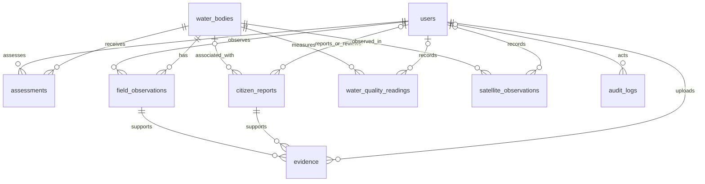

# Database Architecture Proposal

**Status:** Milestone 3 schema implemented in SQLAlchemy and managed by Alembic. Local PostgreSQL/PostGIS execution is pending because Docker is unavailable in the current environment.

**Verification note (2026-11-22):** Docker is not installed. A PostgreSQL 19 service is listening on port 5432, but the project example credentials were rejected; this service is not used because it may belong to the legacy EPICS project. Compose uses port 5433 by default to keep the new JalRakshak database isolated. No database tables were created and no existing data was changed during verification.

## 1. Database platform

Use a new PostgreSQL database named `jalrakshak_db`, with PostGIS enabled. Use SQLAlchemy 2.x and GeoAlchemy2 for persistence and Alembic for schema migrations. Integration tests require a distinct database whose name ends in `_test`; fixtures refuse other names. Connection details come from environment configuration, not source code.

PostgreSQL is the relational source of truth for users, workflows, measurements, and audit records. PostGIS adds spatial types and indexes to the same transaction and integrity model, avoiding a separate GIS data store for the MVP.

## 2. Core entities and relationships

```text
users ──< assessments >── water_bodies
users ──< field_observations >── water_bodies ──< evidence
users ──< citizen_reports >── water_bodies (optional association)
users ──< water_quality_readings >── water_bodies
users ──< satellite_observations >── water_bodies
users ──< audit_logs (actor; entity reference is polymorphic metadata)
```

The nine implemented tables follow the approved MVP design:

- **users**: identity, unique normalized email, password hash, role, account status, phone, created/updated timestamps.
- **water_bodies**: unique code, name/type, administrative location, canonical PostGIS point, optional boundary, area, description, responsible authority, verification status, timestamps.
- **assessments**: water body, five 0–4 component scores, derived total 0–20, date/source/status, assessor and reviewer, remarks, timestamps.
- **field_observations**: water body, observer, date and point, categorical/presence findings, weather, remarks, verification status, timestamps.
- **evidence**: water body, optional linked observation, uploader, generated storage key, original display filename, declared/detected media metadata, description, upload time.
- **satellite_observations**: water body, satellite/scene identifiers, acquisition date, cloud percentage, NDWI/MNDWI/NDTI/NDCI values, estimated area, image storage reference, processing status, provenance.
- **citizen_reports**: citizen, nullable water body association, category, report coordinates, optional location description, description, assigned officer, review/status fields, submitted/updated times. Coordinates are required even before the report is associated with a registered water body.
- **water_quality_readings**: water body, pH/TDS/turbidity/temperature, reading time/source/instrument, remarks, recorder, and explicit provenance/simulation marker.
- **audit_logs**: actor, action, entity type/id, timestamp, and carefully scoped change metadata.

### Implemented relationship diagram



## 3. Integrity and normalization

- Use generated primary keys (UUIDs are preferred for API-facing records) and explicit foreign keys.
- Constrain role, account, verification, report, and processing states to known values.
- Enforce unique email and water body code at the database boundary.
- Enforce score components in the inclusive range 0–4; derive total on the backend from components rather than accepting a client total. Persist the accepted total for efficient reporting and verify it from the same service transaction.
- Constrain percentages and physically meaningful index/measurement ranges where domain rules are established. Avoid inventing unsupported thresholds; document units and validation rules before implementation.
- Citizen reports may refer to unregistered water bodies: `water_body_id` is nullable. Their latitude/longitude (or canonical PostGIS report point) is required, while a human-readable location description is optional. Authorized administrators can review/assign the report and associate it with a registered water body later. Association changes and review/status transitions should be auditable.
- Keep review/verification state and provenance on the record. Audit state transitions and edits so historical changes are traceable.
- Use timezone-aware timestamps in UTC and expose localized display at the client.

## 4. Spatial representation

Use `geometry(Point, 4326)` for representative locations and optional `geometry(MultiPolygon, 4326)` for surveyed boundaries. Create GiST indexes for spatial queries, plus B-tree indexes for foreign keys, status, dates, district/state, and commonly filtered type fields. Validate geometry type, SRID, and coordinate range on input. Return GeoJSON or a documented coordinate representation for Leaflet.

The point geometry is canonical. Latitude and longitude are computed in API responses, not independently editable database columns. Do not fabricate polygon boundaries. Demonstration coordinates for Bhopal water bodies remain explicitly labeled as demonstration/unverified until checked from an authoritative source.

## 5. File and measurement provenance

Binary evidence and satellite imagery stay outside PostgreSQL. Store opaque storage keys and safe metadata in the database; never trust a client-provided path. The development local-storage adapter writes only within the configured upload root. A later object-storage adapter can preserve the same metadata contract.

Water quality records must identify source and indicate whether they are simulated/demo data. Satellite records in the MVP are manually entered metadata and measurements; they are not evidence of an automated processing pipeline. Synthetic seed records must carry an explicit demonstration marker and must not be represented as verified environmental facts.

## 6. Index and retention starting point

Index all foreign keys used for joins; unique email and water body code; water body type, verification status, district/state; assessment and observation dates/status; report status/assigned officer/submission date; measurement acquisition/reading dates; and PostGIS location/boundary columns. Confirm indexes against actual query patterns during implementation rather than indexing every field.

Treat assessments, observations, reports, quality readings, satellite records, and audit history as historical records. Avoid hard-delete behavior that breaks history; the exact deletion/archive policy and retention period are operational decisions to document before implementation.

## 7. Migration sequence proposal

1. Establish database connectivity and PostGIS capability check.
2. Add shared types and users; provide a secure first-admin bootstrap path.
3. Add water bodies and spatial indexes.
4. Add assessments, field observations, evidence metadata, and audit records.
5. Add citizen reports, quality readings, and satellite observation records.
6. Add/adjust constraints and query indexes as workflows become concrete.

Each step is an Alembic migration, reviewed and exercised against both a fresh database and the test database before moving to dependent features.

## 8. Implemented schema reference

Tables are `users`, `water_bodies`, `assessments`, `field_observations`, `evidence`, `citizen_reports`, `water_quality_readings`, `satellite_observations`, and `audit_logs`. All use UUID primary keys. `users` stores a password hash, normalized-email uniqueness boundary, one of citizen/engineer/officer/administrator, active state, and timestamps. `water_bodies` stores code/name/type/admin geography, a canonical `POINT(4326)`, optional valid `MULTIPOLYGON(4326)`, optional area, provenance JSON, and preliminary/verified/rejected status. No separate latitude/longitude columns exist.

Assessments enforce each of five component scores in 0–4 and total in 0–20; application services must calculate the total from components. Observations preserve `observed_at` separately from row creation. Citizen report water body and reporter are nullable to allow anonymous reports for unregistered locations; a PostGIS point remains mandatory. Evidence stores keys and metadata only, requires an observation or report parent, and uses restrictive parent deletion behavior. Quality records retain source and an explicit simulated marker. Satellite records are manual metadata and uniquely identify a satellite scene. Audit entity references are intentionally polymorphic metadata while actor references remain foreign keyed.

Spatial geometry typmods enforce their declared type and SRID; coordinate range and polygon validity checks are database constraints. GiST indexes cover all spatial columns. B-tree indexes cover foreign keys, workflow states and common date/geography filters. Area calculations must transform to a documented projected CRS; EPSG:32643 is suitable for the Bhopal pilot area. GeoJSON coordinates follow longitude, latitude order. Import real water-body outlines only from verified GIS sources, transform them to EPSG:4326, validate them, and store boundaries only after review.

Evidence/image binaries are deliberately outside PostgreSQL. Historical data uses `RESTRICT` deletion for parent records; nullable actor/reporting-user references use `SET NULL`. `audit_logs` are append-oriented and are not automatically deleted with their actor.
